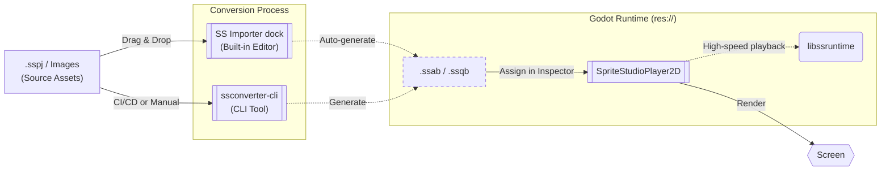

# 🕹️ SpriteStudio Player for Godot

This `develop` branch is a work-in-progress version.  
The stable version can be obtained from the [main branch](https://github.com/cri-middleware/SSPlayerForGodot/tree/main) or from [Releases](https://github.com/cri-middleware/SSPlayerForGodot/releases).  
No warranty or support is provided for this branch, and we cannot respond to feature requests or bug reports.  
Interfaces may change without notice.  

A plugin for playing back animations created with [SpriteStudio](https://www.webtech.co.jp/spritestudio/) inside [Godot Engine](https://godotengine.org/).
Drag a `.sspj` onto the **SS Importer** dock, then drop the converted `.ssab` into the 2D viewport — no code to reach the first frame.

!!! tip "No SpriteStudio data of your own yet?"
    The [official sample data](https://www.webtech.co.jp/help/ja/spritestudio7/download/sample/) works as-is — that page is
    Japanese only, but the downloads themselves are language-neutral.
    [Ringo](https://www.webtech.co.jp/help/ja/spritestudio7/download/sample/#ringo) is a good character sample, and
    [Particle](https://www.webtech.co.jp/help/ja/spritestudio7/download/sample/#Perticle_sample) is a good one if you want effects.

## Table of Contents

- **Setup**
    - [Installation](setup/install.md)
- **Workflow**
    - [Basic Usage](workflow/usage_basic.md)
    - [Asset Import & Editor Integration](workflow/usage_asset_pipeline.md) (start here for the initial `.sspj` import)
    - [Scripting & Events](workflow/usage_scripting.md)
    - [Motion Blending](workflow/motion_blending.md)
    - [UI Buttons](workflow/ui_buttons.md)
    - [Audio Playback](workflow/audio.md)
    - [AnimationPlayer Integration](workflow/animation_player.md)
    - [Exporting Your Project](workflow/export.md)
    - [Generated Assets and Packs](workflow/generated_assets.md) (dependencies, export modes, `.pck`)
- **Advanced Topics**
    - [CLI Conversion & CI/CD](workflow/import.md)
    - [Verifying Playback from the Command Line](workflow/verify_playback.md) (headless checks and a PNG snapshot, for CI and coding assistants)
    - [Performance Tuning and Advanced Settings](workflow/tips.md)
- **API Reference**
    - [SpriteStudioPlayer2D](api/player.md)
    - [Resource Classes](api/resource.md)
- [Troubleshooting](troubleshooting.md)
- [Limitations & Scope](limitations.md)
- [Migration from v1.x](migration_from_v1.md)
- **For Player & SDK Developers**
    - [Build Guide](development/build.md)
    - [How the Player Is Put Together](development/architecture.md) (the layers, and why the player is built the way it is)
- **License**
    - [License](license.md)
    - [Third-Party Notices](third_party_notices.md)

## Key Features

- **Bring your characters to life.** Breathing and blinking, swaying hair and clothes, flashy slash and magic effects — the motion is built visually in a dedicated editor (SpriteStudio) with bone rigs, mesh deformation, particles and per-part add-on shaders, and Godot just plays it. Animations crossfade and layer on tracks at runtime, so a walk eases into a run instead of snapping ([Motion Blending](workflow/motion_blending.md)). Nothing to rebuild by hand in `AnimationPlayer`.
- **Not just characters — effects, UI and whole scenes.** Combine characters, backgrounds, effects and UI into a cutscene or a full-screen sequence in the editor, and play it in Godot as a single animation. `SpriteStudioButton` makes one a Godot button that plays its own section for hover, press, disabled and focus ([UI Buttons](workflow/ui_buttons.md)).
- **Just another node.** `SpriteStudioPlayer2D` sits in your scene like any other node and is controlled from GDScript — with signals from timeline keys, built-in audio playback, per-part overrides, and cellmap texture swaps at runtime ([Scripting & Events](workflow/usage_scripting.md)). The animation lives in its own file rather than inside the scene, so teammates don't collide over scene merges in Git.
- **A seamless SpriteStudio ⇄ Godot round trip.** Drop a `.sspj` onto the SS Importer dock and it is converted inside the editor ([Asset Import & Editor Integration](workflow/usage_asset_pipeline.md)). To tweak it, click **Open SSPJ** in the Inspector, save in SpriteStudio, then click **Reconvert** — no manual export step.
- **Zero-parse loading, SIMD playback.** `.ssab` is a FlatBuffers binary read in place, so loading involves no parsing, and poses are computed by a SIMD-optimised Rust core — light enough for mobile and for scenes with many characters. Turn on **sub-frame interpolation** and motion follows high-refresh-rate displays.

## Overview

The diagram below shows how data flows through the plugin from authored assets to in-game playback.

## Supported Versions

- **Godot Engine**: 4.7 or later.

## Related Repositories

- [SpriteStudio Docs](https://cri-middleware.github.io/SpriteStudio-Docs/) — the documentation portal for the SDK and its official players.
- [SpriteStudio-SDK](https://github.com/cri-middleware/SpriteStudio-SDK) — the SDK itself, providing `libssruntime` / `libssconverter`.
- [SSConverterGUI](https://github.com/cri-middleware/SSConverterGUI) — a standalone desktop GUI for converting `.sspj` without a player.

## Migration

For instructions on migrating from v1.x, please refer to the [Migration Guide](migration_from_v1.md).

## License

See [License](license.md).

For third-party library licenses (such as FlatBuffers and SpriteStudio-SDK dependencies), see [Third-Party Notices](third_party_notices.md).

