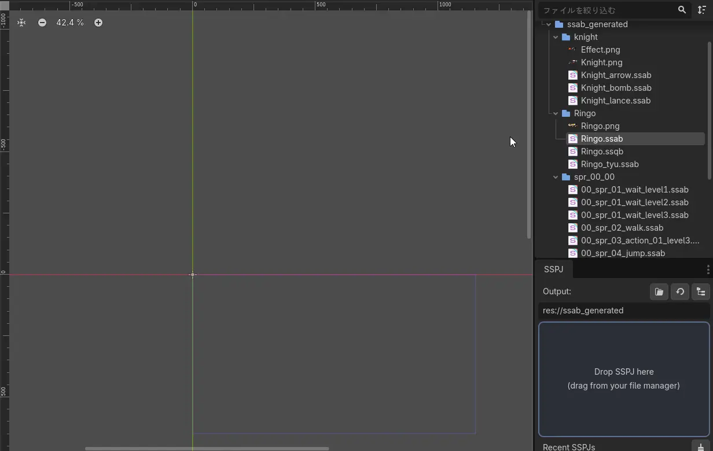
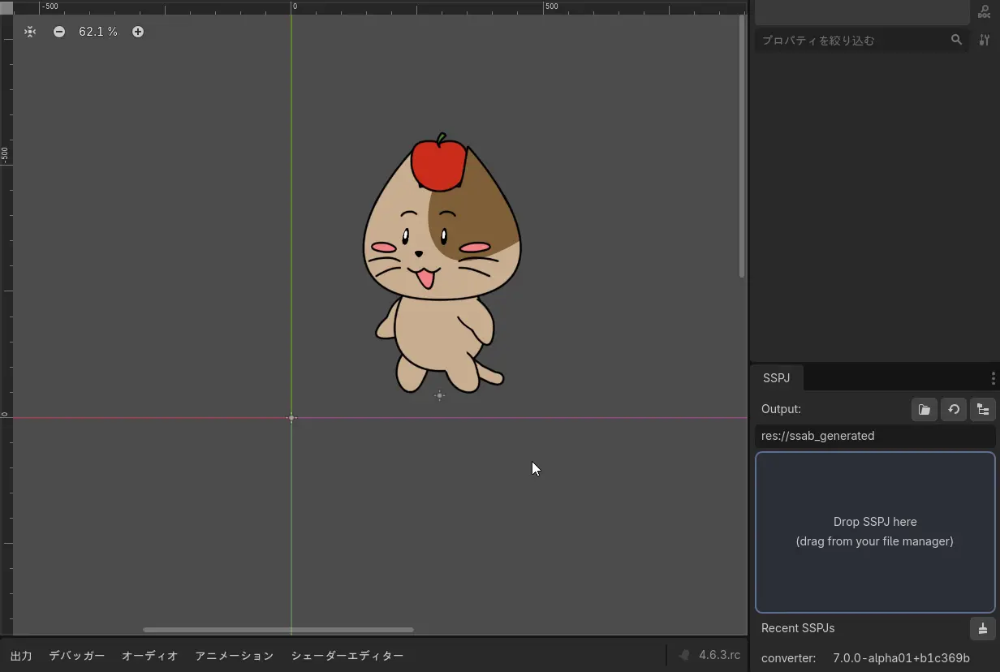
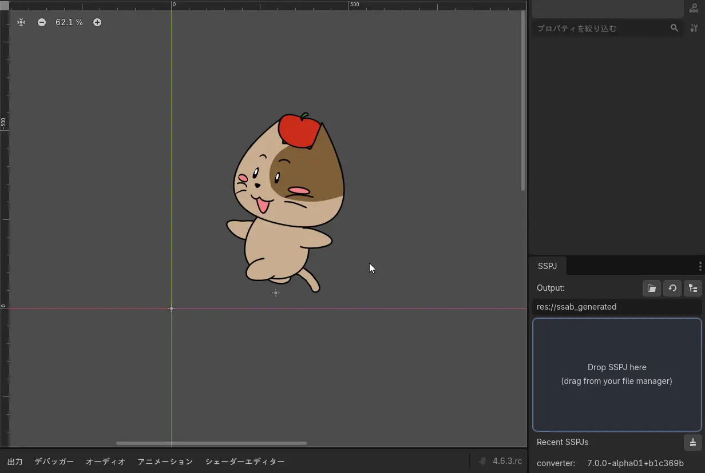

# ▶️ Basic Usage

This page explains the basic workflow for placing and playing SpriteStudio animations in your Godot scene.

> [!NOTE]
> Import first: [Asset Import and Editor Integration](usage_asset_pipeline.md) turns your `.sspj` into the `.ssab` this page places.

## Fastest Setup: Auto Node Creation via Drag & Drop

Taking advantage of Godot's powerful editor, you can set up an animation with the shortest possible workflow.

1. Find the imported **`.ssab` file** in the **FileSystem dock**.
2. **Drag and drop** the file into the **2D workspace (Scene view)**.

This action automatically creates a `SpriteStudioPlayer2D` node and assigns the resource to it.

> [!TIP]
> 
> <video autoplay loop muted playsinline width="100%">
>   <source src="../assets/3-setup_drag_and_drop.webm" type="video/webm">
> </video>
> 

---

## Manual Node Addition and Attachment

If you want to place the node in a specific location within an existing node hierarchy, you can add it manually and assign the resource.

1. Add a `SpriteStudioPlayer2D` node to your scene tree using the "+" button in the Scene dock.
2. Select the added node and open the Inspector.
3. Drag and drop the `.ssab` file from the FileSystem dock into the **`Ssab`** property box in the Inspector to attach it.

---

## Inspector Settings and Preview

Once the node is selected, you can adjust various settings from Godot's Inspector.

1. **Select the `Current Animation`**
   Open the dropdown for the `Current Animation` property in the Inspector. You will see a list of animations contained in the `.ssab`. Select the name of the animation you want to play.

> [!TIP]
> 
> <video autoplay loop muted playsinline width="100%">
>   <source src="../assets/4-inspector_preview-1.webm" type="video/webm">
> </video>
> 

2. **In-Editor Preview**
   With the node selected, the **SpriteStudio** bottom panel appears. Use its transport controls (play from start / play from current / stop, the frame scrubber, and the **Loop** and **Speed** controls next to them) to **play the animation directly in the editor without running the game**. Keyboard shortcuts mirror the AnimationPlayer editor: **D** play from current, **Shift+D** play from start, **S** stop (active while the panel is visible).
   Changes to parameters like `Frame No`, `Speed Scale`, and `Loop Count` are reflected in the preview in real-time, enabling quick adjustments. **Loop** sets `Loop Count` to `-1` (infinite) when on and to `1` when off, and **Speed** sets `Speed Scale`. Both are edits to the scene: they are saved with it and undone with Ctrl+Z, like the same change made in the Inspector.

> [!TIP]
> 
> <video autoplay loop muted playsinline width="100%">
>   <source src="../assets/4-inspector_preview-2.webm" type="video/webm">
> </video>
> 

---

## Main Inspector Properties

| Property                   | Type     | Description                                                         |
| -------------------------- | -------- | ------------------------------------------------------------------- |
| `Ssab`            | Resource | The target `SSABResource` (`.ssab` file) to play                    |
| `Current Animation`        | String   | The name of the currently selected animation                        |
| `Autoplay`                 | bool     | Whether to play automatically when the game starts                  |
| `Speed Scale`              | float    | Playback speed multiplier (Default: 1.0)                            |
| `Loop Count`               | int      | Number of loops (`-1` for infinite loop)                            |

The rest of the Inspector's properties are described in the [SpriteStudioPlayer2D reference](../api/player.md).

---

## Support for Mask Parts

This plugin supports SpriteStudio's "Mask" feature (for its limits, see [Limitations & Scope → Masks](../limitations.md#masks)).
Nothing to set up: mask parts in your `.ssab` clip as authored when you place it in the scene.
