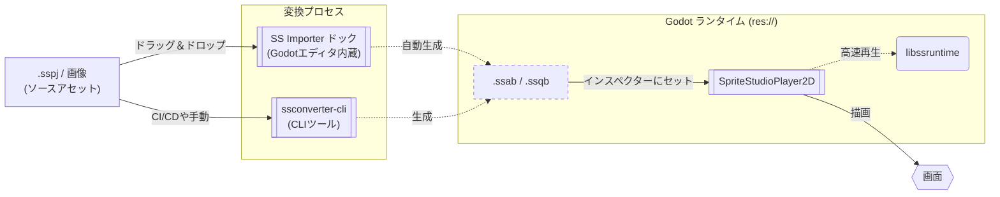

# 🕹️ SpriteStudio Player for Godot

本developブランチは現在開発中のバージョンです。  
安定版は [mainブランチ](https://github.com/cri-middleware/SSPlayerForGodot/tree/main) または、[Releases](https://github.com/cri-middleware/SSPlayerForGodot/releases)から取得してください。  
本developブランチに関してはいかなる保証もサポートも提供しません。リクエストやバグ報告への返信もできません。  
インターフェースは予告なく変更される可能性があります。

[SpriteStudio](https://www.webtech.co.jp/spritestudio/) で作成したアニメーションを [Godot Engine](https://godotengine.org/) 上で再生するためのプラグインです。`.sspj` を **SS Importer** ドックにドラッグし、変換された `.ssab` を 2D ビューポートへドロップすれば、コードを書かずに再生できます。

!!! tip "SpriteStudio のデータが手元に無くても始められます"
    [公式のサンプルデータ](https://www.webtech.co.jp/help/ja/spritestudio7/download/sample/)がそのまま使えます。キャラクターなら
    [Ringo](https://www.webtech.co.jp/help/ja/spritestudio7/download/sample/#ringo)、エフェクトを含むものなら [パーティクル](https://www.webtech.co.jp/help/ja/spritestudio7/download/sample/#Perticle_sample) が手頃です。

## 目次

- **セットアップ**
    - [インストール](setup/install.md)
- **ワークフロー**
    - [基本的な使い方](workflow/usage_basic.md)
    - [アセットのインポートとエディタ連携](workflow/usage_asset_pipeline.md)（初回の `.sspj` インポートはこちら）
    - [スクリプト制御とイベント](workflow/usage_scripting.md)
    - [モーションブレンド](workflow/motion_blending.md)
    - [UI ボタン](workflow/ui_buttons.md)
    - [サウンド再生](workflow/audio.md)
    - [AnimationPlayer との連携](workflow/animation_player.md)
    - [プロジェクトのエクスポート](workflow/export.md)
    - [生成アセットの構成と配信](workflow/generated_assets.md)（依存関係・エクスポートモード・`.pck`）
- **応用**
    - [CLI コンバートと自動化](workflow/import.md)
    - [コマンドラインで再生を検証する](workflow/verify_playback.md)（ヘッドレスでの確認と PNG スナップショット。CI やコーディングアシスタント向け）
    - [パフォーマンスチューニングと高度な設定](workflow/tips.md)
- **API リファレンス**
    - [SpriteStudioPlayer2D](api/player.md)
    - [リソース管理クラス](api/resource.md)
- [トラブルシューティング](troubleshooting.md)
- [制約と適用範囲](limitations.md)
- [v1.x からのマイグレーション](migration_from_v1.md)
- **Player・SDK 開発者向け**
    - [ビルドガイド](development/build.md)
    - [プレイヤーの構成](development/architecture.md)（層と、この作りになっている理由）
- **ライセンス**
    - [ライセンス](license.md)
    - [サードパーティライセンス](third_party_notices.md)

## 主な機能 (Key Features)

- **キャラクターが“生きる”。** 呼吸・まばたき、なびく髪や衣装、斬撃・魔法のエフェクトまで——動きは専用エディタ（SpriteStudio）でボーン・メッシュ変形・パーティクル・パーツ単位のアドオンシェーダを使ってビジュアルに作り込み、Godot はそれを再生するだけ。再生中のアニメーションはトラックに重ねたりクロスフェードしたりでき、歩きから走りへも飛ばずになめらかにつながります（[モーションブレンド](workflow/motion_blending.md)）。`AnimationPlayer` で組み直す必要はありません。
- **キャラクターだけでなく、エフェクトや UI、シーン全体も。** キャラクター・背景・エフェクト・UI を組み合わせたカットシーンや画面全体の演出をエディタで作り、Godot では 1 つのアニメーションとして再生できます。`SpriteStudioButton` を使えば、ホバー・押下・無効・フォーカスごとに別の区間を再生する Godot のボタンにもなります（[UI ボタン](workflow/ui_buttons.md)）。
- **いつものノードとして使える。** `SpriteStudioPlayer2D` は他のノードと同じようにシーンに置き、GDScript から操作できます（タイムラインのキーからのシグナル通知、設定不要のサウンド再生、実行時のパーツ単位の上書き、セルマップのテクスチャ差し替えに対応 — [スクリプト制御とイベント](workflow/usage_scripting.md)）。アニメーションはシーンの外の専用ファイルに入るので、チーム開発でシーンの Git コンフリクトが起きにくくなります。
- **SpriteStudio と Godot をシームレスに往復。** `.sspj` を SS Importer ドックにドロップすれば、エディタ内で変換されます（[アセットのインポートとエディタ連携](workflow/usage_asset_pipeline.md)）。直したくなったらインスペクターの **Open SSPJ** で SpriteStudio を開いて保存し、**Reconvert** を押すだけ。書き出しの手作業は要りません。
- **パース不要の読み込みと SIMD で、軽く滑らかに。** `.ssab` は FlatBuffers のバイナリをそのまま読むので、読み込み時のパースがありません。ポーズ計算は SIMD で最適化した Rust コアが担い、モバイルや大量のキャラクターを出すゲームでも滑らかに動きます。**サブフレーム補間**をオンにすれば、高リフレッシュレートのディスプレイにも追従します。

## 概要 (Overview)

本プラグインを利用してアニメーションを再生する際の流れを以下に示します。

## 対応バージョン

- **Godot Engine**: 4.7 以降。

## 関連リポジトリ

- [SpriteStudio Docs](https://cri-middleware.github.io/SpriteStudio-Docs/ja/) — SDK と公式 Player のドキュメントポータル。
- [SpriteStudio-SDK](https://github.com/cri-middleware/SpriteStudio-SDK) — `libssruntime` / `libssconverter` を提供する SDK 本体。
- [SSConverterGUI](https://github.com/cri-middleware/SSConverterGUI) — Player を介さず `.sspj` を変換するデスクトップ GUI。

## マイグレーション

v1.x 以前のバージョンからの移行手順については、[マイグレーションガイド](migration_from_v1.md) を参照してください。

## ライセンス

[ライセンス](license.md) を参照してください。

サードパーティライブラリ（FlatBuffers, SpriteStudio-SDK の依存クレートなど）のライセンスについては、[サードパーティライセンス](third_party_notices.md) を参照してください。

