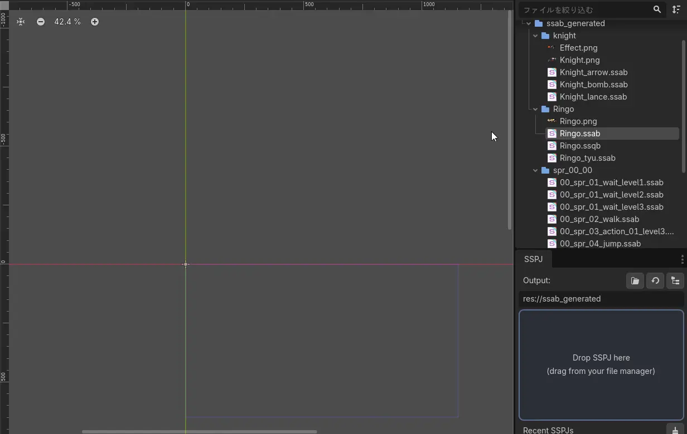
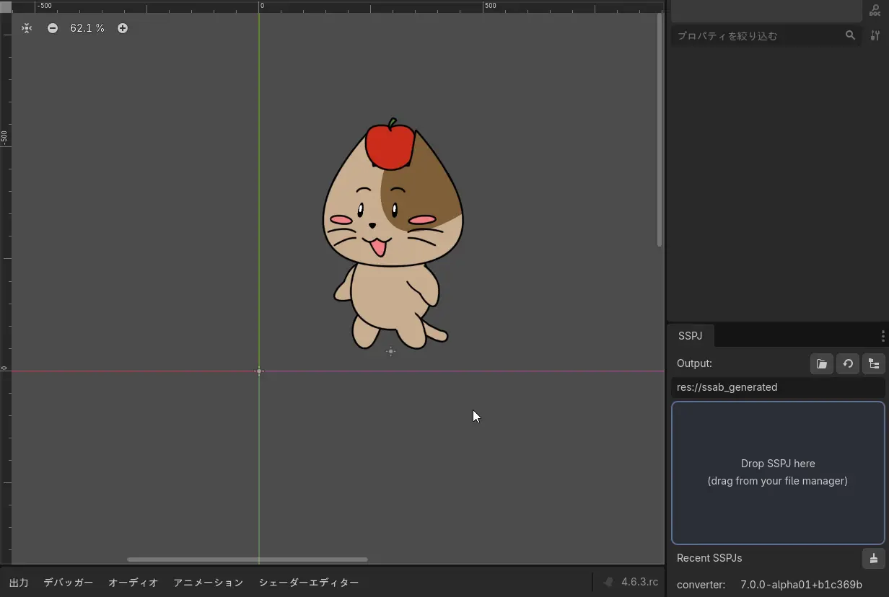
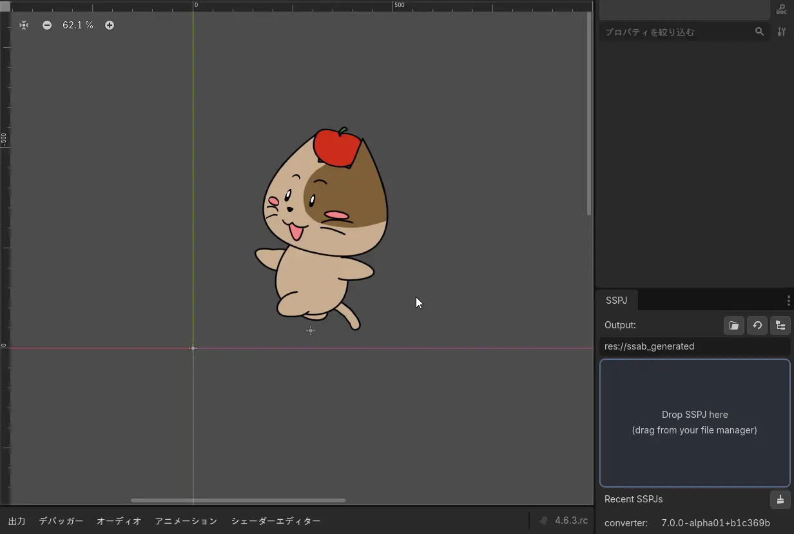

# ▶️ 基本的な使い方

このページでは、Godot のシーン上に SpriteStudio のアニメーションを配置して再生するまでの基本的な手順を解説します。

> [!NOTE]
> 先にインポートします。このページで置く `.ssab` は、[アセットのインポートとエディタ連携](usage_asset_pipeline.md) で `.sspj` から作ります。

## 最速セットアップ: ドラッグ＆ドロップによるノード生成

Godot エディタの強力な機能を活かし、最短の手順でアニメーションをセットアップできます。

1. **ファイルシステムドック**から、インポート済みの **`.ssab` ファイル** を探します。
2. そのファイルを **2D ワークスペース (シーンビュー)** へドラッグ＆ドロップします。

これだけで自動的に `SpriteStudioPlayer2D` ノードがシーンに追加され、リソースの割り当ても完了します。

> [!TIP]
> 
> <video autoplay loop muted playsinline width="100%">
>   <source src="../assets/3-setup_drag_and_drop.webm" type="video/webm">
> </video>
> 

---

## 手動でのノード追加とアタッチ

既存のノード階層の特定の場所に配置したい場合は、手動でノードを追加してリソースを割り当てることも可能です。

1. シーンドックの「＋」ボタンなどから、`SpriteStudioPlayer2D` ノードをシーンツリーに追加します。
2. 追加したノードを選択し、インスペクターを開きます。
3. インスペクターの **`Ssab`** プロパティへ、ファイルシステムドックから `.ssab` ファイルをドラッグ＆ドロップしてアタッチします。

---

## インスペクターでの設定とプレビュー

ノードを選択すると、Godot のインスペクターから各種設定を行えます。

1. **`Current Animation` の選択** インスペクターの `Current Animation` プロパティのドロップダウンを開くと、`.ssab` に含まれるアニメーションのリストが表示されます。再生したいアニメーション名を選択してください。

> [!TIP]
> 
> <video autoplay loop muted playsinline width="100%">
>   <source src="../assets/4-inspector_preview-1.webm" type="video/webm">
> </video>
> 

2. **エディタ上でのプレビュー** ノードを選択すると **SpriteStudio** ボトムパネルが表示されます。先頭から再生 / 現在位置から再生 / 停止のトランスポート、フレームスクラバ、および隣の **Loop** / **Speed** を使って、**ゲームを実行せずにエディタ上でアニメーションを再生**できます。ショートカットは AnimationPlayer エディタと同じく **D** 現在位置から再生 / **Shift+D** 先頭から / **S** 停止（パネルが表示中に有効）。
   `Frame No` や `Speed Scale`、`Loop Count` などのパラメータを変更するとリアルタイムにプレビューへ反映されるため、素早い調整が可能です。**Loop** はオンで `Loop Count` を `-1`（無限）に、オフで `1` にし、**Speed** は `Speed Scale` を書き換えます。どちらもシーンへの編集なので、インスペクターで同じ変更をしたときと同じくシーンに保存され、Ctrl+Z で元に戻せます。

> [!TIP]
> 
> <video autoplay loop muted playsinline width="100%">
>   <source src="../assets/4-inspector_preview-2.webm" type="video/webm">
> </video>
> 

---

## 主なインスペクタープロパティ

| プロパティ                | 型     | 説明                                                                |
| -------------------------- | ------ | ------------------------------------------------------------------- |
| `Ssab`           | Resource | 再生対象の `SSABResource` (`.ssab` ファイル)                     |
| `Current Animation`        | String | 選択中のアニメーション名                                            |
| `Autoplay`                 | bool   | ゲーム開始時に自動再生するかどうか                                  |
| `Speed Scale`              | float  | 再生速度倍率 (既定: 1.0)                                            |
| `Loop Count`               | int    | ループ回数 (`-1` で無限ループ)                                      |

ほかのインスペクタープロパティは [SpriteStudioPlayer2D のリファレンス](../api/player.md) にあります。

---

## マスクパーツへの対応

本プラグインは SpriteStudio の「マスク機能（Mask）」に対応しています（上限などは [制約と適用範囲 → マスク](../limitations.md#マスク) を参照）。設定は要りません。`.ssab` にマスクパーツがあれば、シーンに置くだけで作ったとおりにクリッピングされます。
